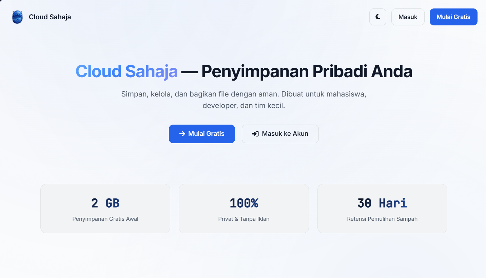
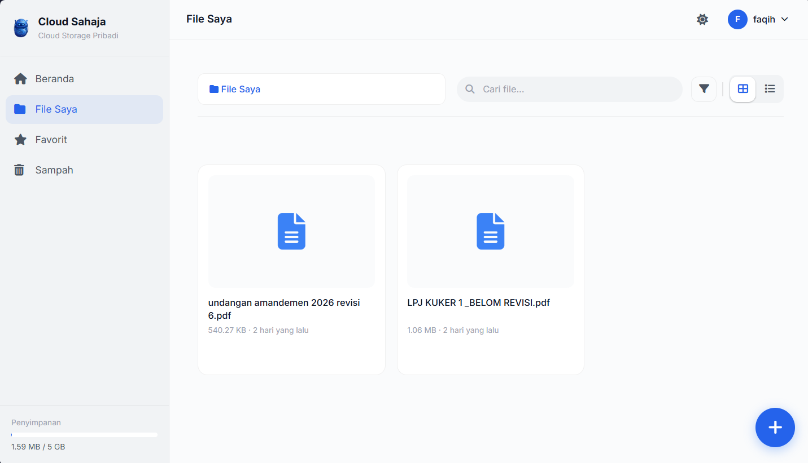
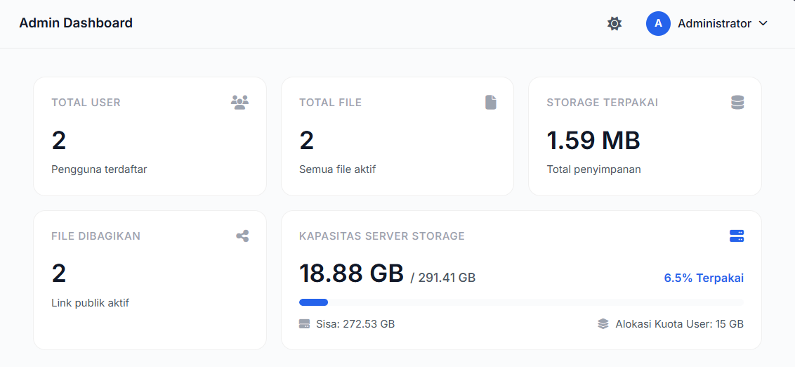

<div align="center">


# ☁️ Cloud Sahaja

**Penyimpanan Awan Pribadi — Dibangun untuk Skala Kecil, Dioptimalkan untuk Keterbatasan.**

[](https://laravel.com)
[](https://php.net)
[](https://sqlite.org)
[](https://tailwindcss.com)
[](https://cloudflare.com)

[Fitur](#-fitur-utama) • [Tech Stack](#-tech-stack) • [Instalasi](#-instalasi-lokal) • [Screenshot](#-screenshot)

</div>

---

## 📖 Tentang Project

**Cloud Sahaja** adalah aplikasi *cloud storage* (penyimpanan awan) pribadi berbasis web. Dibangun sebagai bagian dari ekosistem **SAHAJA AI**, project ini dirancang untuk berjalan dengan sangat ringan (mampu berjalan di server berspesifikasi rendah / *low-end hardware*).

Project ini mendemonstrasikan implementasi *full-stack web development*, mulai dari manajemen file, keamanan, hingga optimasi database untuk lingkungan terbatas.

## ✨ Fitur Utama

- 🔐 **Autentikasi Modern:** Login & Register menggunakan email, atau *One-Tap Login* via Google OAuth.
- 🛡️ **Keamanan Ekstra:** Dilindungi oleh Cloudflare Turnstile (anti-bot / CAPTCHA).
- 📂 **File Manager:** Upload, hapus, buat folder *nested* (bertingkat), dan filter file.
- 👁️ **Preview Langsung:** Lihat file Gambar, PDF, Video, dan Teks langsung di browser tanpa perlu mengunduh.
- 🔗 **Share Link dengan Kontrol:** Bagikan file ke publik dengan opsi masa aktif (expired) link.
- 🗑️ **Sistem Sampah:** File yang dihapus masuk ke *Trash* terlebih dahulu (soft delete) dan bisa dipulihkan.
- 👑 **Admin Panel:** Manajemen pengguna, monitoring *storage* hardisk server, dan pengaturan kuota per user secara *real-time*.
- 🌓 **Dark/Light Mode:** Antarmuka responsif dengan *design system* yang konsisten.

---

## 📸 Screenshot

<div align="center">
  
  <p><em>Halaman Utama (Welcome Page) dengan desain minimalis</em></p>

  
  <p><em>File Manager dengan tampilan Grid & Breadcrumb</em></p>
  
  
  <p><em>Admin Dashboard — Monitoring Server & Kuota</em></p>
</div>

---

## 🛠 Tech Stack

**Backend & Database:**
- ⚙️ **Laravel 12.x** (PHP 8.2) — Framework utama.
- 🗄️ **SQLite 3** — Database *file-based* dengan optimasi **WAL Mode** & `busy_timeout` untuk performa I/O rendah.
- 🔑 **Laravel Socialite** — Integrasi Google OAuth.
- 🔒 **Cloudflare Turnstile** — Validasi form anti-bot.

**Frontend:**
- 🎨 **Tailwind CSS** — *Utility-first CSS framework*.
- 🖼️ **Alpine.js** — Untuk interaksi UI ringan (Dropdown, Modal).
- ✨ **Font Awesome 6** & **Google Fonts** (Inter, JetBrains Mono).

**Infrastruktur & Deployment:**
- 🐧 **Debian 12 (i386)** — Berjalan di *home server* lawas (RAM 2GB).
- 🌐 **Nginx** + **PHP-FPM** (Dioptimalkan untuk memori rendah).
- 🚇 **Cloudflare Tunnel** — Eksposur domain tanpa *port forwarding*.
- 🔒 **Cloudflare SSL** — Enkripsi *end-to-end*.

---

## 🚀 Instalasi Lokal

Ingin menjalankan project ini di komputermu? Ikuti langkah ini:

1. **Clone repository:**
   ```bash
   git clone https://github.com/faqihhidayah876/cloud-sahaja.git
   cd cloud-sahaja
   ```

2. **Install dependensi Composer:**
   ```bash
   composer install
   ```

3. **Setup Environment:**
   Salin file `.env.example` ke `.env`.
   ```bash
   cp .env.example .env
   php artisan key:generate
   ```

4. **Konfigurasi Database & API Keys:**
   Buka `.env` dan sesuaikan:
   - `DB_CONNECTION=sqlite` (Buat file `database/database.sqlite` manual).
   - Masukkan `GOOGLE_CLIENT_ID`, `GOOGLE_CLIENT_SECRET`, `GOOGLE_REDIRECT_URI`.
   - Masukkan `TURNSTILE_SITE_KEY` & `TURNSTILE_SECRET_KEY`.

5. **Migrasi Database & Storage Link:**
   ```bash
   php artisan migrate
   php artisan storage:link
   ```

6. **Build Asset Frontend:**
   ```bash
   npm install
   npm run build
   ```

7. **Jalankan Server:**
   ```bash
   php artisan serve
   ```
   Buka `http://127.0.0.1:8000`.

---

<div align="center">

**Dibuat oleh: [Faqih Hidayah](https://github.com/faqihhidayah876)**

*“Think Global, Act Local.”* 🇮🇩

</div>
